# 🚀 Production LLMOps & MLOps Enterprise Portfolio

<p align="center">
  
  
  
  
  
  
  
  
  
  
</p>

---

## 📌 Executive Summary

This repository houses an industry-ready portfolio of **LLMOps and MLOps end-to-end production systems**. Each project is engineered following enterprise best practices: modular microservices, decoupled ETL pipelines, robust custom exception hierarchies, structured JSON logging, declarative configuration management, automated evaluation frameworks, and cloud-native CI/CD automation across **AWS, Azure, Docker, and Kubernetes**.

From **Autonomous Agentic RAG** with **Model Context Protocol (MCP)** to **QLoRA Distributed Fine-Tuning on AWS SageMaker**, **Multimodal Vector Discovery**, and **Real-Time Threat Detection**, this repository demonstrates real-world AI applications built for reliability, scalability, and measurable business impact.

---

## 🏛️ System Architecture Blueprint

```mermaid
flowchart TD
    subgraph Ingestion_ETL["Data Ingestion & Preprocessing"]
        A1["Raw Documents (PDF / TXT / DOCX)"] --> B1["Document Chunking & Embeddings"]
        A2["Web Scraping & Product Reviews"] --> B2["ETL Data Pipeline"]
        A3["Real-time URL Feature Extractor"] --> B3["30+ Lexical, DNS & SSL Features"]
        A4["Multimodal Image Catalogs"] --> B4["CLIP Embeddings & Ingestion"]
    end

    subgraph Core_Engines["Core Intelligence & Orchestration"]
        B1 --> C1["Enterprise Document Portal (FAISS / Multi-LLM RAG)"]
        B2 --> C2["E-Comm Assistant (Agentic RAG + MCP Servers)"]
        B3 --> C3["PhishGuard Detection (XGBoost + ANN MLP)"]
        B4 --> C4["Multimodal Search (Qdrant Vector DB)"]
        D1["Domain Instruction Data"] --> C5["AWS SageMaker (PEFT / QLoRA Fine-Tuning)"]
        D2["Web Search & Wikipedia"] --> C6["LangGraph Multi-Agent Research Engine"]
    end

    subgraph Observability_Eval["Evaluation, Tracking & MLOps"]
        C2 --> E1["Ragas Evaluation (Faithfulness, Precision)"]
        C3 --> E2["MLflow Experiment Tracking & Model Registry"]
        C4 --> E3["Recall@K & Model Comparison Benchmarks"]
    end

    subgraph Deployment_Cloud["Production Infrastructure & CI/CD"]
        C1 --> F1["AWS ECS Fargate & CloudFormation"]
        C2 --> F2["Kubernetes (EKS) + ECR + GitHub Actions"]
        C5 --> F3["SageMaker Endpoint + AWS Lambda Serverless"]
        C6 --> F4["Docker + Jenkins CI/CD on Azure"]
        C3 --> F5["Docker Microservice + GitHub Actions CI/CD"]
        C4 --> F6["FastAPI Backend + Streamlit UI"]
    end
```



---

## 📂 Projects Portfolio Matrix

| Project | Domain | Core Tech Stack | LLMOps / MLOps Highlights | Infrastructure & Deployment |
| :--- | :--- | :--- | :--- | :--- |
| **[1. Automated Research Report Generation](#1-automated-research-report-generation)** | Autonomous Agents & Synthesis | LangGraph, LangChain, Tavily, OpenAI/Gemini/Groq, FastAPI | Multi-agent interview workflow, iterative report synthesis, citations, DOCX/PDF export | Docker, Jenkinsfile CI/CD, Azure deployment scripts |
| **[2. Enterprise Document Portal](#2-enterprise-document-portal)** | Document Intelligence & RAG | FastAPI, LangChain, FAISS, Google/Groq/OpenAI | Deep document analysis, comparative multi-doc RAG, modular vector storage | AWS CloudFormation, Amazon ECS Fargate, ECR, GitHub Actions |
| **[3. E-Commerce Product Assistant](#3-ecomm-intelligent-product-assistant)** | Agentic RAG & MCP | LangChain, Astra DB, MCP Protocol, Ragas, FastAPI | Model Context Protocol server, agentic search fallback, automated RAG evaluation | Kubernetes (EKS manifests), AWS CloudFormation, GitHub Actions |
| **[4. Domain LLM Fine-Tuning on AWS](#4-domain-specific-llm-fine-tuning-on-aws)** | LLM Fine-Tuning & Serving | PyTorch, Hugging Face, PEFT (QLoRA), SageMaker | Distributed 4-bit LoRA training, automated endpoint deployment, serverless integration | AWS SageMaker Estimator, SageMaker Endpoint, AWS Lambda |
| **[5. Phishing Website Detection](#5-phishing-website-detection-mlops-pipeline)** | Cyber-Threat MLOps | XGBoost, ANN (PyTorch/Sklearn), MLflow, FastAPI | 30+ real-time DNS/SSL/HTML feature extraction, experiment tracking, model registry | Docker containerization, GitHub Actions CI/CD, FastAPI UI |
| **[6. Multimodal Semantic Image Search](#6-multimodal-semantic-image-search)** | Multimodal Vector Search | OpenCLIP (ViT-B-32), Qdrant Vector DB, Streamlit, FastAPI | Zero-shot visual discovery, multilingual query translation, Recall@K benchmark suite | Docker-ready, Qdrant Cloud / Local, FastAPI + Streamlit UI |

---

## 🛠️ In-Depth Project Walkthroughs

---

### 1. Automated Research Report Generation
> **Autonomous Multi-Agent Research, Interview, and Report Synthesis System**

* **Directory:** [`automated-research-report-generation/`](./automated-research-report-generation)
* **Problem Statement:** Synthesizing high-depth technical research reports requires hours of manual querying, cross-referencing sources, and formatting.
* **Solution Architecture:**
  - **LangGraph Multi-Agent Workflows:** Two synchronized state graphs:
    1. *Interview Workflow:* Gathers structured research constraints, scope, and target persona.
    2. *Report Generator Workflow:* Coordinates autonomous web search agents via Tavily and Wikipedia to compile sections with verifiable source citations.
  - **Dynamic Multi-LLM Provider Engine:** Seamless runtime switching across DeepSeek-R1 (Groq), Gemini-2.0-Flash (Google GenAI), and GPT-4o (OpenAI).
  - **Document Generation:** Automated output compilation into Microsoft Word (`.docx`) and Adobe PDF (`.pdf`) formats.
  - **Production API & UI:** FastAPI backend with user authentication (`users.db`), async task execution tracking, and modern dashboard.
  - **DevOps:** Fully configured `Jenkinsfile` and Azure deployment shell scripts (`azure-deploy-jenkins.sh`).

```bash
# Quickstart
cd automated-research-report-generation
pip install -r requirements.txt
uvicorn research_and_analyst.api.main:app --reload
```

---

### 2. Enterprise Document Portal
> **Production Document Intelligence, Comparative Analysis & Conversational RAG**

* **Directory:** [`document_portal/`](./document_portal)
* **Problem Statement:** Organizations struggle to parse, compare, and query disparate unstructured PDF documents while keeping hallucination rates near zero.
* **Solution Architecture:**
  - **Three-Pillar Capability:**
    1. *Document Analyzer:* Comprehensive structural breakdown, entity extraction, and executive summaries.
    2. *Document Chat (Conversational RAG):* Context-grounded conversational search with citation tracking.
    3. *Document Comparator:* Cross-document comparative analysis identifying discrepancies and clause variations.
  - **Vector Architecture:** FAISS in-memory and on-disk indexed vector stores with Google `text-embedding-004`.
  - **Production Infrastructure as Code:** AWS CloudFormation template (`document-portal-cf.yaml`) automating ECS Fargate, Application Load Balancers, and VPC networking.
  - **CI/CD:** Multi-stage GitHub Actions workflows (`ci.yaml`, `aws.yaml`) running unit tests and deploying Docker containers to Amazon ECR.

```bash
# Quickstart
cd document_portal
pip install -r requirements.txt
python api/main.py
```

---

### 3. E-Comm Intelligent Product Assistant
> **Agentic RAG Assistant with Model Context Protocol (MCP) & Ragas Evaluation**

* **Directory:** [`ecomm-prod-assistant/`](./ecomm-prod-assistant)
* **Problem Statement:** Standard product recommendation bots lack real-time catalog access, hallucinate product specifications, and lack standardized tooling interfaces.
* **Solution Architecture:**
  - **Model Context Protocol (MCP) Integration:** Features dedicated MCP Server (`product_search_server.py`) and Client (`client.py`) allowing the LLM to inspect live product inventory and real-time review sentiment dynamically.
  - **Agentic Workflows:** Fallback mechanism routing between localized vector retrieval (DataStax Astra DB / Vector Search) and live web search.
  - **End-to-End ETL Pipeline:** Includes automated product scraper (`data_scrapper.py`, `scrapper_ui.py`) transforming raw e-commerce reviews into vector embeddings.
  - **LLMOps Evaluation with Ragas:** Automated pipeline evaluating context precision, faithfulness, and answer relevancy.
  - **Cloud-Native Kubernetes:** Complete K8s manifests (`deployment.yaml`, `service.yaml`) and AWS CloudFormation for EKS with ECR (`infra/eks-with-ecr.yaml`).

```bash
# Quickstart
cd ecomm-prod-assistant
pip install -r requirements.txt
python prod_assistant/router/main.py
```

---

### 4. Domain-Specific LLM Fine-Tuning on AWS
> **Parameter-Efficient QLoRA Fine-Tuning & Serverless Inference Architecture on AWS SageMaker**

* **Directory:** [`Finetuning-on-aws/`](./Finetuning-on-aws)
* **Problem Statement:** General-purpose LLMs struggle with domain-specific terminology, specialized protocols (e.g. healthcare, pharma), and compliance constraints.
* **Solution Architecture:**
  - **PEFT / QLoRA Fine-Tuning:** Fine-tunes causal language models using Hugging Face `transformers` and `peft` in 4-bit precision with LoRA rank adaptations (`scripts/train.py`).
  - **AWS SageMaker Distributed Estimator:** Programmatic training launcher (`estimator_launcher.ipynb`) spinning up GPU instances (e.g. `ml.g5.2xlarge`) and managing training checkpoints.
  - **Real-Time Model Serving:** Automated deployment pipeline (`deployment_of_model.ipynb`) provisioning SageMaker real-time inference endpoints.
  - **Serverless Integration:** AWS Lambda handler (`lambda_function.py`) providing an event-driven serverless bridge to the SageMaker endpoint.
  - **Interactive Applications:** Streamlit diagnostic app (`rag_app_ui.py`) and FastAPI service (`rag_app_backend.py`) for live clinical inference.

---

### 5. Phishing Website Detection (MLOps Pipeline)
> **Full-Lifecycle MLOps Cyber-Threat Detection Pipeline with Real-Time Feature Engineering**

* **Directory:** [`phising-website-detection/`](./phising-website-detection)
* **Problem Statement:** Malicious phishing websites evolve faster than static domain blocklists, requiring instant feature computation and ML inference on raw URLs.
* **Solution Architecture:**
  - **Real-Time Feature Engineering Engine:** `website_feature_extraction.py` extracts 30+ lexical, domain, DNS, SSL, and HTML features directly from any input URL in milliseconds.
  - **Dual Model Engine:** Evaluates and serves both optimized gradient boosted decision trees (**XGBoost**) and Artificial Neural Networks (**MLP / ANN**).
  - **MLflow Experiment Tracking & Registry:** Logs hyperparameters, confusion matrices, ROC-AUC curves, and model artifacts with an active SQLite tracking backend (`mlflow.db`).
  - **Containerized Service:** Dockerized FastAPI application (`Dockerfile`, `api/main.py`) with complete CI/CD via GitHub Actions (`.github/workflows/deploy.yaml`).

```bash
# Run Training & Pipeline
cd phising-website-detection
pip install -r requirements.txt
python run_pipeline.py

# Start Prediction API
uvicorn api.main:app --host 0.0.0.0 --port 8000
```

---

### 6. Multimodal Semantic Image Search
> **Zero-Shot Multimodal Visual Discovery Engine Powered by CLIP and Qdrant**

* **Directory:** [`sementic-image-search/`](./sementic-image-search)
* **Problem Statement:** Keyword-based image search fails to understand natural language nuances, aesthetic qualities, and multilingual context.
* **Solution Architecture:**
  - **Multimodal Embedding Space:** Utilizes OpenCLIP (`ViT-B-32`, trained on LAION-2B) to embed images and natural language queries into a unified 512-dimensional vector space.
  - **High-Performance Vector Indexing:** Integrated with **Qdrant Vector Database**, featuring payload metadata filtering, cosine similarity search, and cloud/local persistence.
  - **Query Translation Layer:** Utilizes LLM query interpretation (`query_translator.py`) to handle complex multilingual and conceptual queries.
  - **Offline Evaluation Suite:** Automated Jupyter notebooks benchmarking `Recall@K` and comparing embedding model variations.
  - **Full-Stack Interface:** Streamlit interactive visual explorer (`ui/app.py`) backed by high-throughput FastAPI endpoints (`backend/main.py`).

```bash
# Run Backend & Frontend
cd sementic-image-search
pip install -r requirements.txt
uvicorn semantic_image_search.backend.main:app --reload --port 8000
streamlit run semantic_image_search/ui/app.py --server.port 8501
```

---

## 🌳 Monorepo Directory Structure

```plaintext
LLMOPS-Projects/
├── .github/                                # Repository-level GitHub configurations
├── .gitignore                              # Comprehensive root ignore rules
├── LICENSE                                 # MIT License
├── README.md                               # Root documentation and portfolio index
│
├── automated-research-report-generation/   # Autonomous Multi-Agent Research System
│   ├── azure-deploy-jenkins.sh             # Azure deployment automation
│   ├── Dockerfile                          # Application container manifest
│   ├── Jenkinsfile                         # CI/CD pipeline definition
│   ├── pyproject.toml                      # Package specifications
│   └── research_and_analyst/               # Core agentic workflows & FastAPI app
│
├── document_portal/                        # Enterprise Document Intelligence & Comparative RAG
│   ├── .github/workflows/                  # GitHub Actions (CI + AWS ECS Fargate deploy)
│   ├── api/                                # FastAPI application routes & endpoints
│   ├── infrastructure/                     # AWS CloudFormation (document-portal-cf.yaml)
│   ├── src/                                # Ingestion, Chat, and Comparison engines
│   └── tests/                              # Pytest test suite
│
├── ecomm-prod-assistant/                   # Agentic RAG with Model Context Protocol (MCP)
│   ├── .github/workflows/                  # CI/CD deployment pipelines
│   ├── infra/                              # AWS EKS CloudFormation infrastructure
│   ├── k8/                                 # Kubernetes Deployment & Service manifests
│   └── prod_assistant/                     # MCP servers, Ragas eval, Agentic workflows
│
├── Finetuning-on-aws/                      # Domain LLM Fine-Tuning & Serving on AWS
│   ├── deployment_of_model.ipynb           # SageMaker endpoint deployment notebook
│   ├── estimator_launcher.ipynb            # SageMaker training job launcher
│   ├── lambda_function.py                  # Serverless AWS Lambda API bridge
│   ├── scripts/train.py                    # PEFT QLoRA 4-bit fine-tuning script
│   └── inference_app.py                    # Streamlit clinical assistant interface
│
├── phising-website-detection/              # Threat Detection MLOps Pipeline
│   ├── .github/workflows/                  # CI/CD automated deployment workflow
│   ├── api/                                # FastAPI real-time prediction microservice
│   ├── artifacts/                          # Serialized models (XGBoost, ANN, Scaler)
│   ├── mlruns/ & mlflow.db                 # MLflow experiment tracking database
│   ├── src/                                # Feature extraction (30+ rules) & training
│   └── run_pipeline.py                     # End-to-end training pipeline orchestrator
│
└── sementic-image-search/                  # Multimodal Visual Discovery Platform
    ├── images/                             # Image catalog and benchmarking datasets
    └── semantic_image_search/              # CLIP embeddings, Qdrant client, Streamlit UI
```

---

## ⚙️ Global Environment Setup & Prerequisites

### 1. Prerequisites
* **Python:** Version 3.10 or 3.11 recommended
* **Docker:** Installed and running locally for containerized testing
* **AWS CLI:** Configured (`aws configure`) if working with SageMaker, ECS, or EKS modules
* **Kubectl:** If deploying Kubernetes manifests in the e-commerce assistant

### 2. Environment Variables Configuration
Each project contains a `.env.copy` template. Copy the template to `.env` inside any target project directory and configure the necessary credentials:

```bash
# Example API Keys across projects
GROQ_API_KEY="your-groq-api-key"
GOOGLE_API_KEY="your-gemini-api-key"
OPENAI_API_KEY="your-openai-api-key"
TAVILY_API_KEY="your-tavily-api-key"
ASTRA_DB_API_ENDPOINT="your-datastax-astra-endpoint"
ASTRA_DB_APPLICATION_TOKEN="your-astra-token"
QDRANT_URL="http://localhost:6333" # or Qdrant Cloud URL
QDRANT_API_KEY="your-qdrant-api-key"
AWS_DEFAULT_REGION="us-east-1"
```

---

## 🏆 Production Engineering Standards

All projects across this repository adhere to strict enterprise software engineering standards:

1. **Configuration-Driven Design:** Hyperparameters, model identifiers, vector collections, and chunking parameters are stored in declarative YAML files (`config.yaml`), eliminating hardcoded values.
2. **Standardized Logging & Error Handling:** Every module utilizes unified custom loggers and custom exception classes that capture file names, line numbers, and error messages for immediate debugging.
3. **Automated Quality Gates:** Test suites (`pytest`) and evaluation frameworks (`Ragas`, `Recall@K`, `MLflow`) evaluate outputs systematically prior to deployment.
4. **Cloud-Native & Container-Ready:** Every service includes production-ready Dockerfiles, health-check endpoints, and CI/CD automation templates for zero-downtime rollouts.

---

## 📜 License

Distributed under the **MIT License**. See [`LICENSE`](./LICENSE) for full details.

---

## 👨‍💻 Author & Contact

**Mohd Zaheeruddin**  
* *GitHub:* [@zaheerjklabs](https://github.com/zaheerjklabs)  
* *Email:* [zaheerjklabs@gmail.com](mailto:zaheerjklabs@gmail.com)  
* *Focus:* LLMOps, Agentic AI, Generative AI Systems & Cloud-Native MLOps
